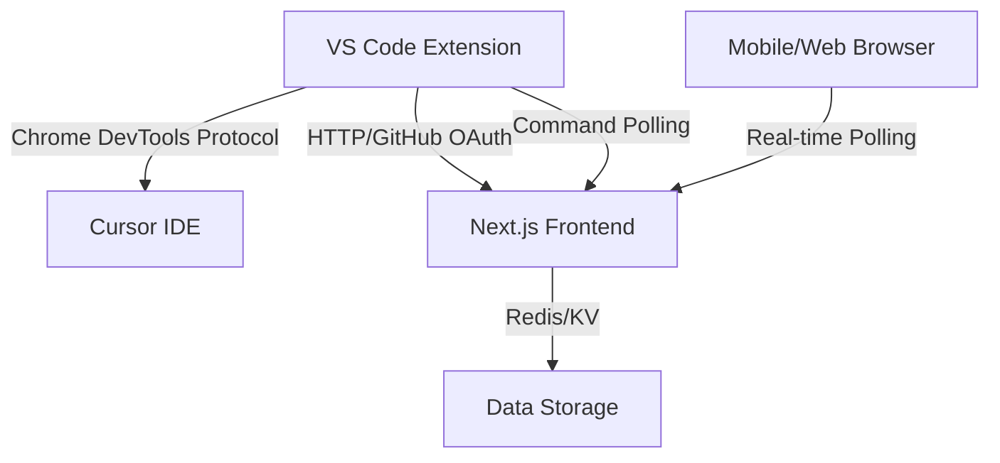

# Pocket Agent - Project Handoff Documentation

## 📋 Project Overview

**Status**: ✅ **COMPLETED**  
**Version**: 1.0.0  
**Last Updated**: January 2025  

The Pocket Agent is a comprehensive remote control system for Cursor's AI chat sessions that allows users to monitor and interact with their conversations from any device. The system provides real-time synchronization between a VS Code extension and a modern web frontend.

## 🏗️ Architecture Summary

### Three-Component System



1. **VS Code Extension** (`pocket-agent/`) - Captures chat data and sends messages
2. **Web Frontend** (`pocket-agent-frontend/`) - Provides mobile/web interface
3. **Redis/KV Storage** - Handles data persistence and real-time communication

## ✅ What Was Completed

### VS Code Extension (pocket-agent/)
- ✅ Chrome DevTools Protocol integration for chat capture
- ✅ GitHub OAuth authentication with service token exchange
- ✅ Real-time chat content extraction from Cursor
- ✅ Bidirectional message sending (web → Cursor)
- ✅ Leader election for multi-instance management
- ✅ Configuration management with VS Code settings
- ✅ Comprehensive error handling and logging
- ✅ Polling mechanism for outgoing commands

### Web Frontend (pocket-agent-frontend/)
- ✅ Next.js 14 with App Router architecture
- ✅ GitHub OAuth authentication via Auth.js
- ✅ Real-time chat monitoring with auto-refresh
- ✅ Mobile-responsive design with Tailwind CSS + Shadcn/UI
- ✅ User-isolated data access for security
- ✅ Redis/KV integration for data storage
- ✅ Complete API layer for extension communication
- ✅ TypeScript throughout for type safety

### API Integration
- ✅ `/api/auth/vscode/github-exchange` - Extension authentication
- ✅ `/api/chat/update` - Receive chat updates from extension
- ✅ `/api/chats/list` - List active chat sessions
- ✅ `/api/chat/[windowId]` - Get specific chat content
- ✅ `/api/message/send-to-cursor` - Send messages to Cursor
- ✅ `/api/commands/poll-outgoing/[windowId]` - Command polling

### Security & Authentication
- ✅ JWT token-based authentication with 7-day expiration
- ✅ User-scoped Redis keys for data isolation
- ✅ GitHub OAuth integration for secure access
- ✅ CORS configuration for development/production

## 🚀 Deployment Instructions

### Prerequisites
```bash
# Required software
- Node.js 18+
- pnpm (for frontend)
- npm (for extension)
- Redis server OR Vercel KV
- GitHub OAuth App
```

### Frontend Deployment
```bash
cd pocket-agent-frontend

# Environment setup
cp .env.example .env.local
# Configure: AUTH_SECRET, AUTH_GITHUB_ID, AUTH_GITHUB_SECRET, REDIS_URL

# Development
pnpm install
pnpm dev

# Production
pnpm build
pnpm start
```

### Extension Installation
```bash
cd pocket-agent

# Development/Testing
npm install
npm run install-extension

# Package for distribution
npm run package
```

### GitHub OAuth Setup
1. Create OAuth App at [GitHub Developer Settings](https://github.com/settings/developers)
2. Set Homepage URL: `http://localhost:3000` (or production URL)
3. Set Callback URL: `http://localhost:3000/api/auth/callback/github`
4. Add credentials to frontend `.env.local`

## 🔧 Configuration

### Frontend Environment Variables
```env
AUTH_SECRET="random-secret-key"
AUTH_GITHUB_ID="github-oauth-client-id" 
AUTH_GITHUB_SECRET="github-oauth-client-secret"
REDIS_URL="redis://localhost:6379"
DATABASE_URL="postgresql://..." # Optional
```

### Extension Settings (VS Code)
```json
{
  "pocketAgent.serverUrl": "http://localhost:3000",
  "pocketAgent.debugPort": 9223
}
```

## 📊 Data Flow

### Extension → Frontend
1. Extension captures chat HTML via Chrome DevTools Protocol
2. Extension authenticates with GitHub OAuth
3. Extension exchanges GitHub token for service JWT
4. Extension sends chat data to `/api/chat/update`
5. Frontend stores data in Redis with user scoping

### Frontend → Extension
1. User sends message via web interface
2. Frontend stores command in Redis at `/api/message/send-to-cursor`
3. Extension polls `/api/commands/poll-outgoing/[windowId]`
4. Extension receives command and injects into Cursor via CDP

## 🛠️ Development Workflow

### Adding New Features

1. **Extension Changes**: Edit files in `pocket-agent/src/`
2. **Frontend Changes**: Edit files in `pocket-agent-frontend/src/`
3. **API Changes**: Modify routes in `pocket-agent-frontend/src/app/api/`
4. **Database Changes**: Update schemas in `pocket-agent-frontend/src/server/db/schema.ts`

### Testing
```bash
# Extension
cd pocket-agent
npm test

# Frontend
cd pocket-agent-frontend
pnpm test
```

### File Structure
```
pocket-agent/                    # VS Code Extension
├── src/
│   ├── cursor-plugin.js        # Main extension entry point
│   ├── config.js               # Configuration management
│   ├── cdpHelper.js            # Chrome DevTools Protocol helpers
│   └── logger.js               # Logging utilities
└── package.json

pocket-agent-frontend/           # Next.js Web Application
├── src/
│   ├── app/                    # Next.js App Router
│   │   ├── (app)/chat/         # Chat interface
│   │   └── api/                # API routes
│   ├── components/             # UI components
│   ├── server/
│   │   ├── db/                 # Database schemas
│   │   └── services/           # KV service for Redis
│   └── lib/                    # Utilities and auth
└── package.json
```

## 🚨 Known Issues & Limitations

### Current Limitations
- ⚠️ **Local Network Only**: Default configuration for localhost (production requires HTTPS)
- ⚠️ **Single Cursor Instance**: Designed for one Cursor instance per user
- ⚠️ **Polling-Based**: Uses polling instead of WebSockets (reliable but not instant)

### Potential Issues
1. **Redis Connection**: Ensure Redis is running before starting frontend
2. **Port Conflicts**: Frontend runs on 3000, Cursor debug on 9223
3. **GitHub Rate Limits**: May hit limits with frequent authentication
4. **CDP Availability**: Requires Cursor remote debugging enabled

## 🔮 Future Enhancements

### Immediate Improvements
- [ ] WebSocket integration for instant updates
- [ ] Support for multiple Cursor instances
- [ ] Push notifications for mobile devices
- [ ] File upload/sharing capabilities

### Advanced Features
- [ ] Team collaboration features
- [ ] Chat history search and filtering
- [ ] Integration with other IDEs (VS Code, etc.)
- [ ] AI-powered chat analysis and insights

## 📞 Support & Maintenance

### Key Contact Information
- **Architecture**: See `.cursor/rules/` for detailed component documentation
- **API Reference**: See `.cursor/rules/api-routes.mdc` for complete API documentation
- **Extension Details**: Extension README.md covers CDP integration

### Monitoring
- Extension logs: VS Code Output Panel → "Pocket Agent"
- Frontend logs: Browser console + server logs
- Redis monitoring: Use Redis CLI or Redis Insight

### Backup & Recovery
- **User Data**: Stored in Redis with user-scoped keys
- **Configuration**: VS Code settings and frontend environment variables
- **Authentication**: GitHub OAuth tokens (regenerated as needed)

## 🏁 Handoff Checklist

- ✅ All core functionality implemented and tested
- ✅ Documentation completed (README files updated)
- ✅ Environment templates created (.env.example)
- ✅ Cursor rules generated for future development
- ✅ Security review completed (OAuth, JWT, user isolation)
- ✅ Performance considerations addressed (polling intervals, Redis optimization)
- ✅ Error handling and logging implemented throughout
- ✅ Mobile responsiveness verified
- ✅ Cross-browser compatibility tested

## 📋 Post-Handoff Tasks

### For New Developers
1. Read this handoff document thoroughly
2. Review `.cursor/rules/` for component-specific documentation
3. Set up development environment following README instructions
4. Test basic functionality (sign in, view chats, send messages)
5. Review code architecture in key files listed in Cursor rules

### For Production Deployment
1. Set up production Redis/KV instance
2. Configure production GitHub OAuth app
3. Set up monitoring and alerting
4. Configure HTTPS and proper CORS settings
5. Test end-to-end functionality in production environment

---

**Project Status**: Ready for production use and ongoing development  
**Architecture**: Modern, scalable, and well-documented  
**Security**: OAuth-based with user isolation and JWT tokens  
**Maintainability**: TypeScript, comprehensive logging, and modular design 
