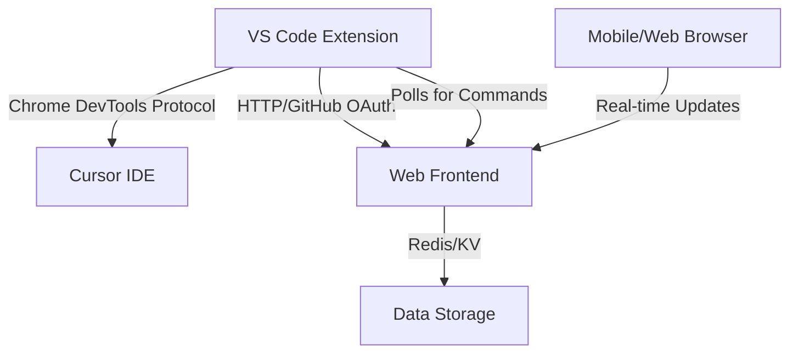

# Pocket Agent for Cursor

A comprehensive remote control system for Cursor's AI chat sessions, allowing you to monitor and interact with your conversations from any device. The system consists of a VS Code extension and a modern web frontend with real-time synchronization.

## ✨ Features

- 🔐 **Secure Authentication** - GitHub OAuth integration for secure access
- 💬 **Real-time Chat Monitoring** - View live Cursor chat sessions from any device
- 📱 **Mobile-Friendly Interface** - Responsive web design for desktop, tablet, and mobile
- ⚡ **Live Updates** - Automatic polling for new messages and chat updates
- 🔄 **Bidirectional Communication** - Send messages to Cursor from the web interface
- 👥 **Multi-User Support** - Each user has isolated access to their own chats
- 🎨 **Modern UI** - Built with Next.js, Tailwind CSS, and Shadcn/UI components

## 🏗️ Architecture

The Pocket Agent system consists of three main components:



1. **VS Code Extension** - Captures chat data from Cursor via Chrome DevTools Protocol
2. **Web Frontend** - Next.js application providing the mobile/web interface  
3. **Redis/KV Storage** - Stores chat data and commands for real-time communication

## 🚀 Quick Start

### 1. VS Code Extension Setup

```bash
# Install dependencies
npm install

# Package and install the extension
npm run install-extension
```

### 2. Authentication Setup

1. Set up the frontend web application (separate repository)
2. Create a GitHub OAuth App at [GitHub Developer Settings](https://github.com/settings/developers)
3. Configure OAuth App:
   - Homepage URL: `http://localhost:3000`
   - Authorization callback URL: `http://localhost:3000/api/auth/callback/github`
4. In VS Code/Cursor, run "Pocket Agent: Sign In" from the command palette

## 📖 Documentation

- **[Extension Documentation](./.cursor/rules/)** - VS Code extension architecture and workflow
- **[Project Handoff](./HANDOFF.md)** - Complete system documentation and deployment guide

## 🛠️ Development

### Extension Development

```bash
npm install
npm run compile
npm run test
```

### Testing

```bash
npm test                    # Run unit tests
npm run install-extension  # Install for manual testing
```

For frontend development, see the separate frontend repository.

## 🔧 Configuration

### Extension Settings

The extension can be configured via VS Code settings or environment variables:

- **Server URL**: Defaults to `http://localhost:3000`
- **Debug Port**: Defaults to `9223` (Cursor's debug port)

Environment variables:
- `POCKET_AGENT_SERVER_URL` - Override server URL
- `CURSOR_DEBUG_PORT` - Override Cursor debug port

### VS Code Settings

```json
{
  "pocketAgent.serverUrl": "http://localhost:3000",
  "pocketAgent.debugPort": 9223
}
```

## 🔒 Security

- GitHub OAuth authentication for secure access
- JWT tokens with 7-day expiration
- User-isolated data storage
- CORS configuration for development/production
- HTML sanitization for chat content display

## 🐛 Troubleshooting

### Common Issues

1. **Extension not connecting to frontend:**
   - Ensure frontend is running on port 3000
   - Check VS Code extension is signed in with GitHub
   - Verify GitHub OAuth app configuration

2. **Redis connection errors:**
   - Install and start Redis locally: `redis-server`
   - Or configure Vercel KV for cloud storage

3. **Chat content not updating:**
   - Ensure Cursor has remote debugging enabled (default port 9223)
   - Check VS Code extension output channel for errors
   - Verify extension has leader status (only one instance polls)

### Debug Mode

Enable detailed logging by setting `NODE_ENV=development` in your environment.

## 🤝 Contributing

1. Fork the repository
2. Create a feature branch: `git checkout -b feature/amazing-feature`
3. Make your changes and test thoroughly
4. Commit changes: `git commit -m 'Add amazing feature'`
5. Push to branch: `git push origin feature/amazing-feature`
6. Open a pull request

## 📝 License

MIT License - see [LICENSE](LICENSE) for details.

## 🙏 Acknowledgments

- Built with [VS Code Extension API](https://code.visualstudio.com/api)
- Frontend powered by [Next.js](https://nextjs.org)
- UI components from [Shadcn/UI](https://ui.shadcn.com)
- Authentication via [Auth.js](https://authjs.dev) 
